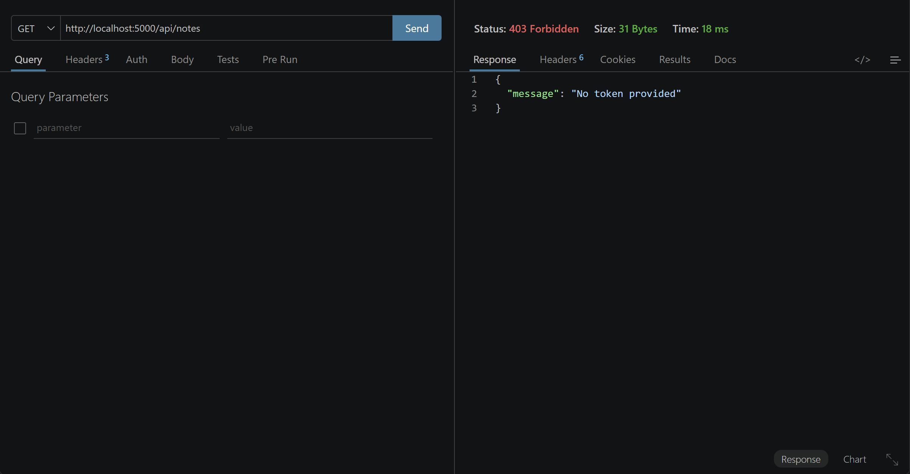

# SecureConnect Platform

A secure backend built with **Node.js, Express, MongoDB, JWT and Socket.IO**. It provides user authentication, role-based access control (RBAC), a protected notes API, an event-driven logging system and real-time chat rooms.

## Tech Stack

- Node.js and Express.js
- MongoDB with Mongoose
- JSON Web Tokens (`jsonwebtoken`) for authentication
- bcrypt for password hashing
- Socket.IO for real-time chat
- Node.js `EventEmitter` for event-driven features
- dotenv, nodemon
- Thunder Client (API testing in VS Code)

## Project Structure

```
Ass_4/
├── middleware/
│   └── auth.js          # JWT authentication and role authorization
├── models/
│   ├── User.js          # User schema (with role)
│   └── Note.js          # Note schema (linked to owner)
├── routes/
│   ├── auth.js          # Signup and login
│   ├── notes.js         # Protected notes CRUD
│   └── admin.js         # Admin-only routes
├── screenshots/         # API test screenshots
├── events.js            # Central event bus
├── socket.js            # Socket.IO server with JWT check
├── server.js            # App entry point
├── package.json
└── .gitignore
```

## Getting Started

1. Install dependencies:
   ```bash
   npm install
   ```
2. Create a `.env` file in the project root:
   ```
   PORT=5000
   MONGO_URI=your_mongodb_connection_string
   JWT_SECRET=your_secret_key
   JWT_EXPIRES_IN=1h
   ```
3. Start the server:
   ```bash
   npm start
   ```

The server runs at `http://localhost:5000`.

## Data Models

**User**

| Field | Type | Notes |
|-------|------|-------|
| `username` | String | Required |
| `email` | String | Required, unique, lowercase |
| `password` | String | Required, stored as a bcrypt hash |
| `role` | String | `user` (default) or `admin` |

**Note**

| Field | Type | Notes |
|-------|------|-------|
| `title` | String | Required |
| `content` | String | Required |
| `owner` | ObjectId | Reference to the User who created it |

## API Endpoints

| Method | Endpoint | Access | Description |
|--------|----------|--------|-------------|
| POST | `/api/auth/signup` | Public | Register a new user |
| POST | `/api/auth/login` | Public | Login and receive a JWT |
| POST | `/api/notes` | Authenticated | Create a note |
| GET | `/api/notes` | Authenticated | Get own notes (admin gets all) |
| GET | `/api/notes/:id` | Owner or admin | Get a single note |
| PUT | `/api/notes/:id` | Owner or admin | Update a note |
| DELETE | `/api/notes/:id` | Owner or admin | Delete a note |
| GET | `/api/admin/users` | Admin only | List all users (without passwords) |

Protected routes need the token in the header:

```
Authorization: Bearer <token>
```

The token is also set as an `httpOnly` cookie on login.

## API Testing Screenshots

All endpoints were tested using Thunder Client in VS Code.

### 1. User Signup
`POST /api/auth/signup`


### 2. User Login
`POST /api/auth/login`

Returns a JWT token on successful login.


### 3. Create Note
`POST /api/notes`


### 4. Get Notes
`GET /api/notes`


### 5. Access Without Token (403)
Protected routes reject requests that have no token.



### 6. Real-time Chat (Socket.IO)
Two logged-in users (Aditi and Rohan) connected with their JWTs, joined the `general` room and exchanged messages. The server log shows the connections, room joins, messages and the event-driven logs.


## Key Features

- **Secure authentication**: passwords hashed with bcrypt, login returns a signed JWT with an expiry time
- **JWT middleware**: verifies the token from the `Authorization` header or the cookie
- **Role-based access control**: `authorizeRoles('admin')` restricts routes such as `/api/admin/users`
- **Ownership checks**: a user can only read, edit or delete their own notes, while an admin can access all
- **Event-driven design**: `EventEmitter` logs `user:registered`, `user:login`, `note:created` and `note:deleted`
- **Real-time chat**: Socket.IO rooms with `joinRoom` and `chatMessage` events, and JWT verification on every socket connection
- **Proper status codes**: 201 created, 400 validation, 401 invalid credentials or token, 403 no token or access denied, 404 not found, 409 duplicate email
- **Secrets protected**: `.env` and `node_modules` are listed in `.gitignore`

## Conclusion

SecureConnect combines authentication, authorization, a protected REST API, event handling and real-time communication in one backend. All tested endpoints returned the expected responses.

