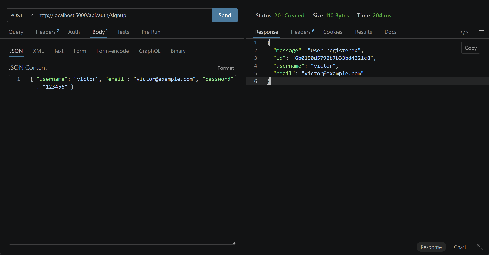
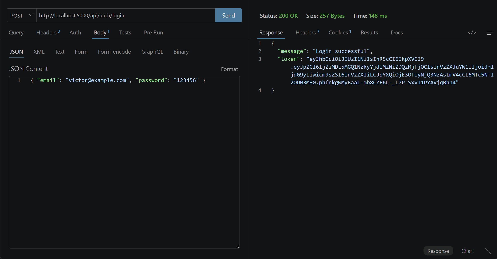
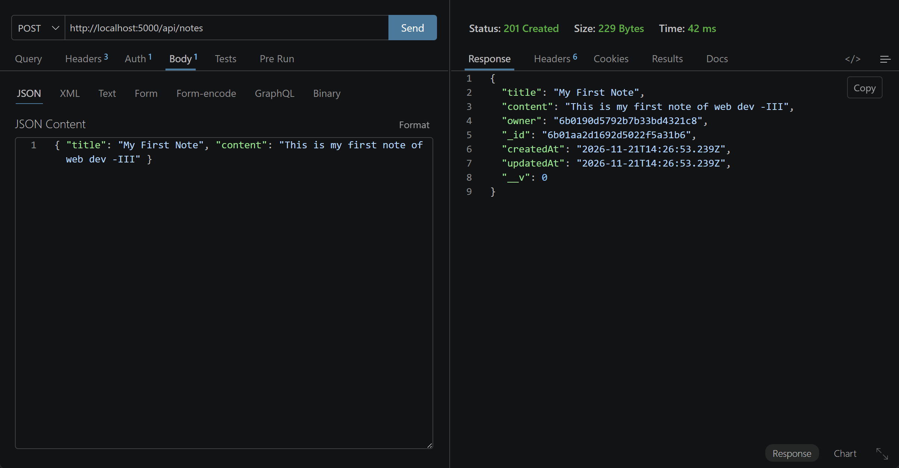
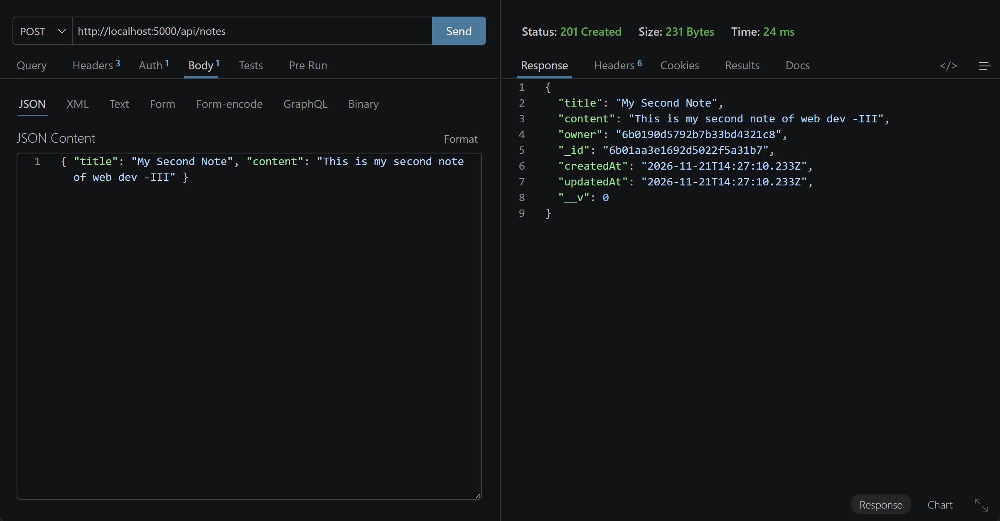
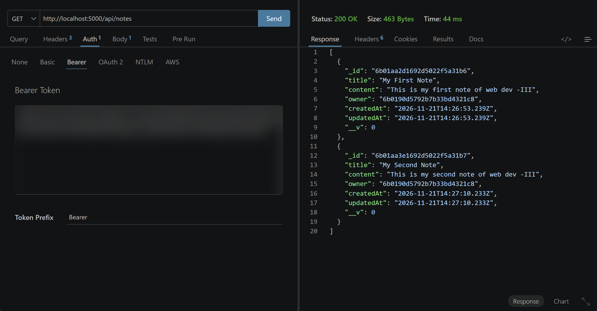
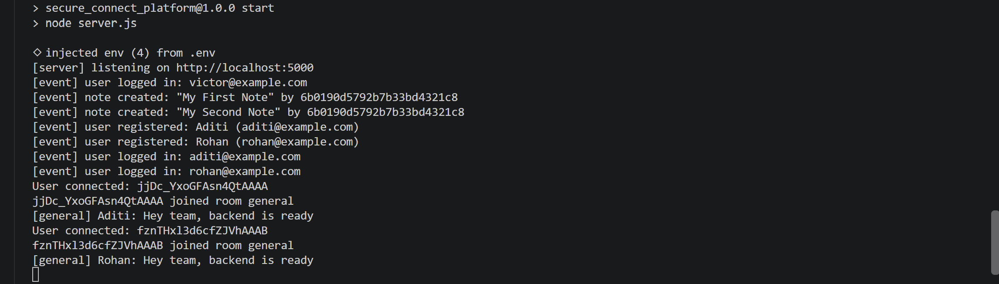

# SecureConnect Platform

## Aim

To build a secure backend using Node.js, Express and MongoDB that supports user authentication with JWT, role-based access control (RBAC), a protected notes API, event-driven logging and real-time chat using Socket.IO.

## Tools Used

- Node.js and Express.js
- MongoDB and Mongoose
- JSON Web Token (`jsonwebtoken`)
- bcrypt
- Socket.IO
- Node.js `EventEmitter`
- dotenv and nodemon
- Thunder Client (VS Code extension) for API testing
- Git and GitHub

## Project Structure

```
Ass_4/
├── middleware/auth.js     # JWT authentication and role check
├── models/
│   ├── User.js
│   └── Note.js
├── routes/
│   ├── auth.js            # Signup and login
│   ├── notes.js           # Protected notes CRUD
│   └── admin.js           # Admin-only route
├── screenshots/
├── events.js              # Event bus
├── socket.js              # Socket.IO chat with JWT check
├── server.js
└── package.json
```

## Steps to Run

1. Install dependencies:
   ```bash
   npm install
   ```
2. Create a `.env` file in the project root:
   ```
   PORT=5000
   MONGO_URI=your_mongodb_connection_string
   JWT_SECRET=your_secret_key
   JWT_EXPIRES_IN=1h
   ```
3. Start the server:
   ```bash
   npm start
   ```
4. Server runs at `http://localhost:5000`

## API Endpoints

| Method | Endpoint | Access | Description |
|--------|----------|--------|-------------|
| POST | `/api/auth/signup` | Public | Register a new user |
| POST | `/api/auth/login` | Public | Login and get JWT token |
| POST | `/api/notes` | Logged in | Create a note |
| GET | `/api/notes` | Logged in | Get own notes (admin gets all) |
| GET | `/api/notes/:id` | Owner / Admin | Get one note |
| PUT | `/api/notes/:id` | Owner / Admin | Update a note |
| DELETE | `/api/notes/:id` | Owner / Admin | Delete a note |
| GET | `/api/admin/users` | Admin only | List all users |

Protected routes need this header:

```
Authorization: Bearer <token>
```

## Output

### 1. Signup
`POST /api/auth/signup`



### 2. Login
`POST /api/auth/login`



### 3. Create Note (first note)
`POST /api/notes`



### 4. Create Note (second note)
`POST /api/notes`



### 5. Get All Notes
`GET /api/notes`



### 6. Request Without Token (403)
`GET /api/notes` without a token is rejected.


### 7. Real-time Chat and Event Logs
Two users joined the `general` room and exchanged messages. The server log also shows the event-driven logs.



## Features Implemented

- User signup and login with bcrypt password hashing
- JWT authentication with token expiry
- Role-based access control (user and admin)
- Protected notes CRUD with ownership checks
- Event-driven logging using `EventEmitter`
- Real-time chat rooms using Socket.IO with JWT verification
- Proper HTTP status codes (201, 400, 401, 403, 404, 409)
- `.env` and `node_modules` ignored in Git

## Conclusion

The SecureConnect platform was built and tested successfully. Authentication, authorization, the notes API, event handling and real-time chat all work as expected, and the outputs are shown in the screenshots above.